# Serverless Pipeline: AWS Lambda + DynamoDB + Scheduled S3 JSON Exports

A hands-on AWS project: two Python Lambda functions move data from a public REST API into DynamoDB, then export the table to timestamped JSON files in a private S3 bucket every 2 minutes on an EventBridge Scheduler schedule. Both functions are monitored with CloudWatch Logs and Metrics.

| | |
|---|---|
| **Region** | `us-east-1` (US East, N. Virginia) |
| **Approach** | AWS Management Console + Python 3 (Boto3, `urllib`) |
| **Status** | ✅ Completed, verified, and all resources cleaned up |

---

## Architecture

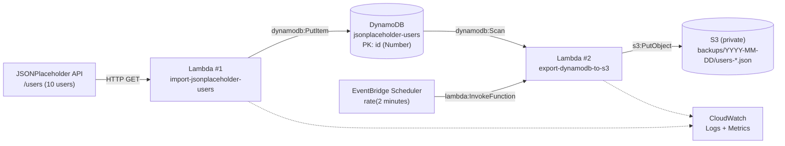

**How the data flows**

1. **Lambda #1** is invoked manually. It fetches 10 sample users from `https://jsonplaceholder.typicode.com/users` and writes each full user object (including the nested `address` and `company`) to DynamoDB with `PutItem`.
2. **EventBridge Scheduler** invokes **Lambda #2** about every 2 minutes.
3. **Lambda #2** scans every page of the table, converts DynamoDB `Decimal` values to JSON-safe numbers, and uploads a JSON array to S3 under a unique key:
   `backups/<UTC-date>/users-<HH-MM-SS-microseconds>-<request-id>.json`
4. Both functions write application logs (`print()`) and runtime logs to CloudWatch. Lambda also publishes the Invocations, Errors, and Duration metrics automatically.

No access keys appear anywhere in the code. Boto3 gets temporary credentials from each function's **IAM execution role**.

---

## Resources Created

| Service | Name | Key settings |
|---|---|---|
| DynamoDB | `jsonplaceholder-users` | Partition key `id` (**Number**), no sort key, on-demand |
| S3 | `jsonplaceholder-users-bucket` | General purpose, Block all public access **ON**, SSE-S3 encryption |
| Lambda #1 | `import-jsonplaceholder-users` | Python 3.15, x86_64, 128 MB, 30 s timeout, env `TABLE_NAME` |
| Lambda #2 | `export-dynamodb-to-s3` | Python 3.15, x86_64, 128 MB, 30 s timeout, env `TABLE_NAME`, `BUCKET_NAME`, `BACKUP_PREFIX=backups` |
| EventBridge Scheduler | `dynamodb-backup-every-2min` | Recurring, `rate(2 minutes)`, flexible window Off, target Lambda #2 |
| IAM | 3 roles | One execution role per Lambda + one Scheduler role (details below) |

---

## Implementation and Evidence

### 1. DynamoDB table

The partition key `id` is a **Number** because the API returns `"id": 1`, not `"id": "1"`. If the key were a String, `PutItem` would fail with a `ValidationException`.

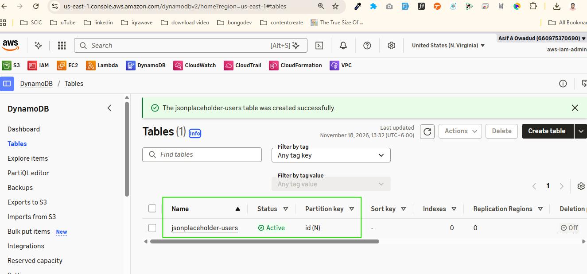

### 2. Lambda #1: import users

The function's role has **only** `dynamodb:PutItem` on this one table, plus the managed `AWSLambdaBasicExecutionRole` for CloudWatch logging.

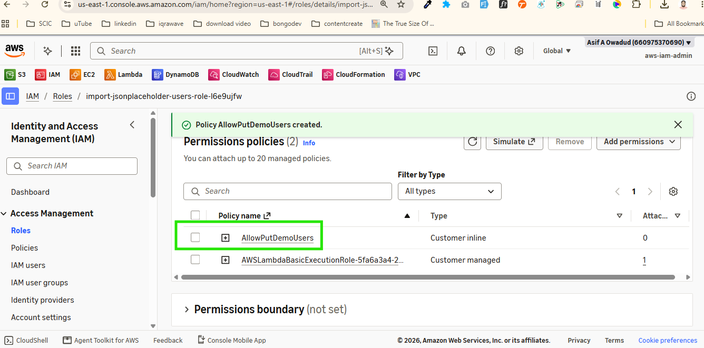

Manual test with event `{}` returned `statusCode 200` and `saved_count 10`:

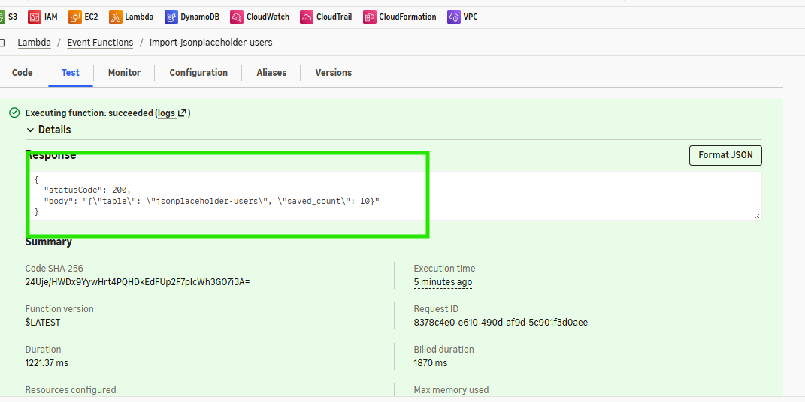

CloudWatch log stream for `/aws/lambda/import-jsonplaceholder-users`:

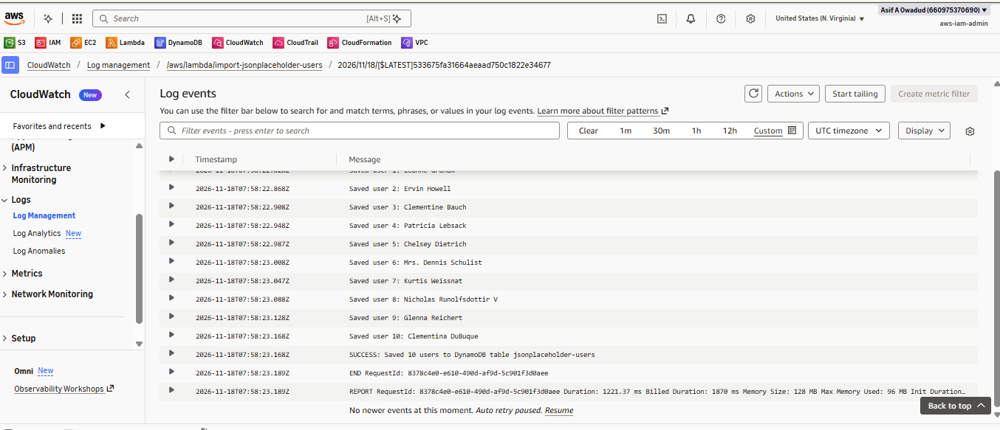

All 10 users in DynamoDB. Running the import a second time still leaves 10 items:

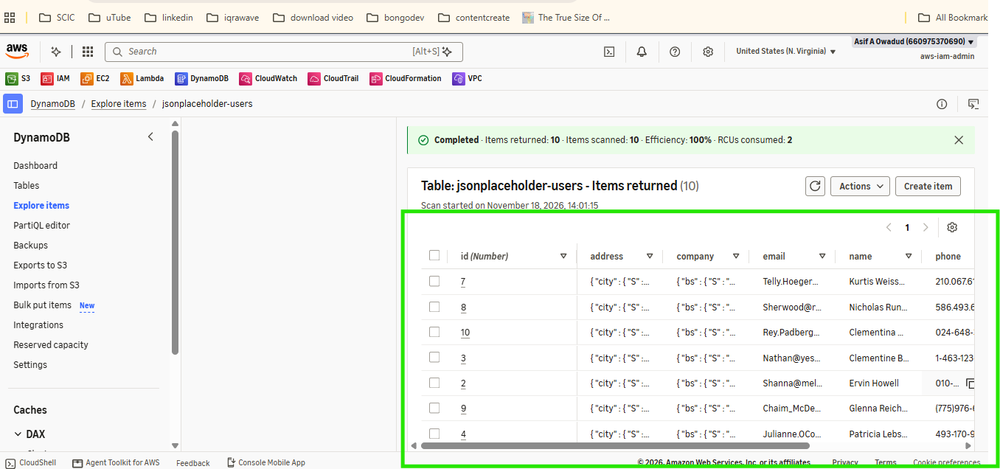

### 3. Lambda #2: export to S3

The function's role has **only** `dynamodb:Scan` on the table and `s3:PutObject` under `backups/*`:

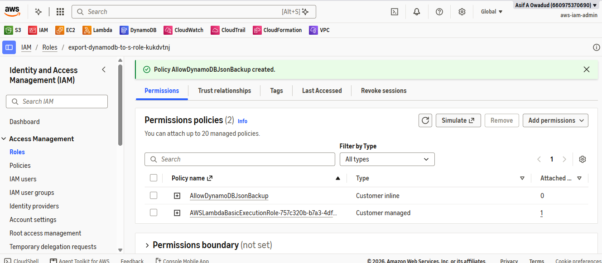

Manual test with event `{}` returned `exported_count 10`, an `s3_uri`, and `scan_pages 1`:

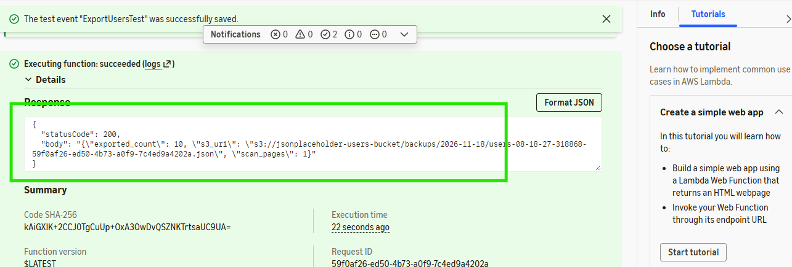

Two manual runs produced two separate files. Neither overwrote the other:

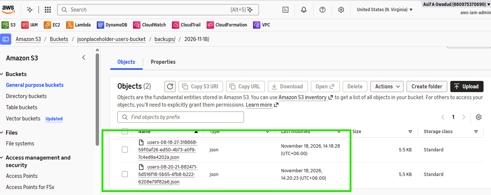

Content of one export file (JSON array of users with nested address and company):

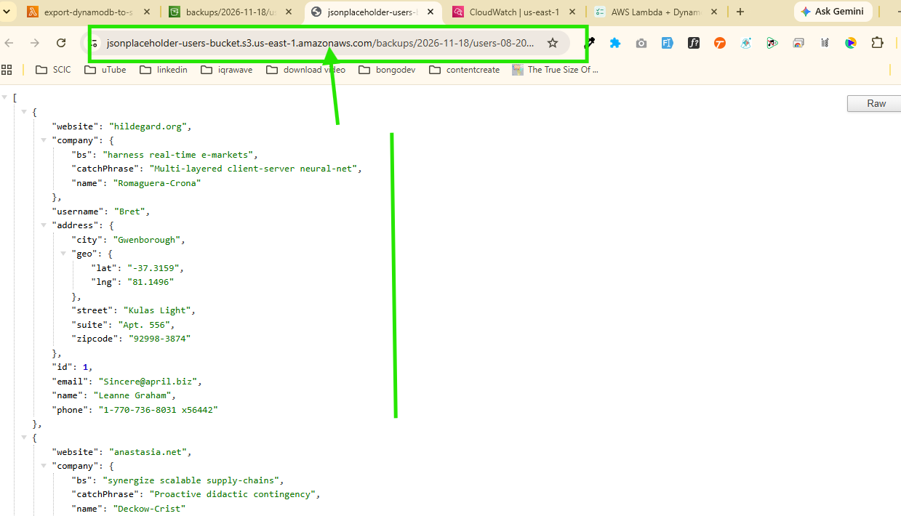

### 4. Automation with EventBridge Scheduler

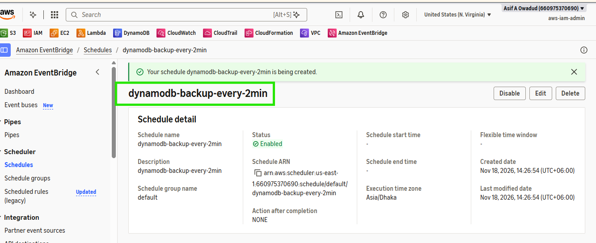

New files appeared roughly every 2 minutes without any manual action:

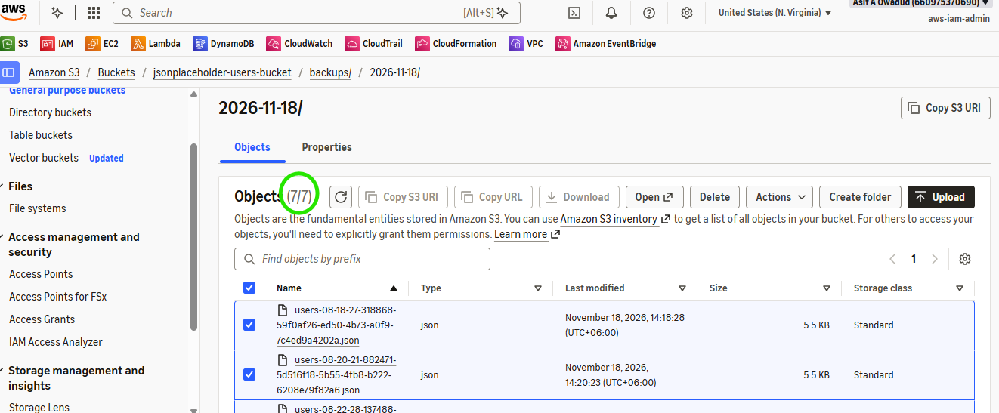

### 5. Observability

Lambda #2 Invocations graph (with Errors at 0):

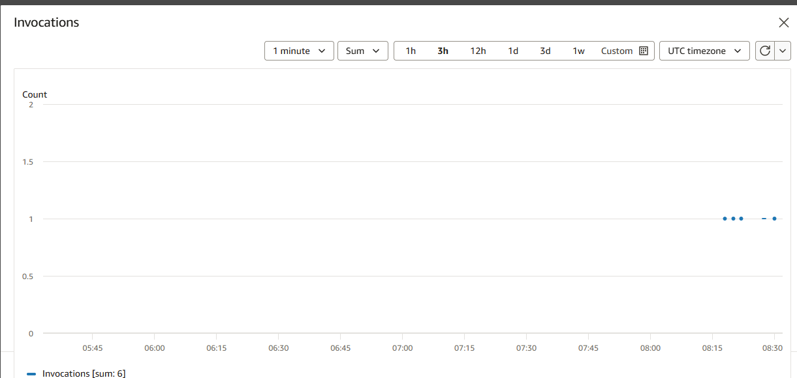

Lambda #1 monitoring:

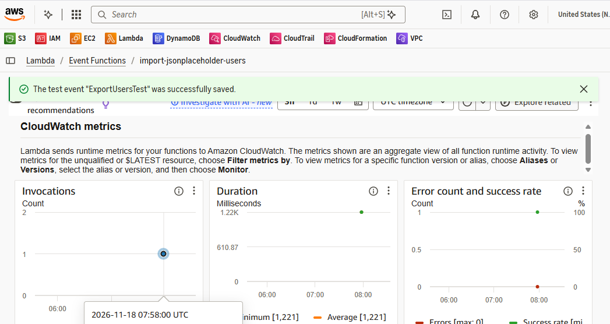

### 6. Cleanup

The schedule was **disabled first**, then deleted. After that, both Lambda functions, the DynamoDB table, the S3 objects and bucket, both log groups, and the three lab IAM roles were deleted.

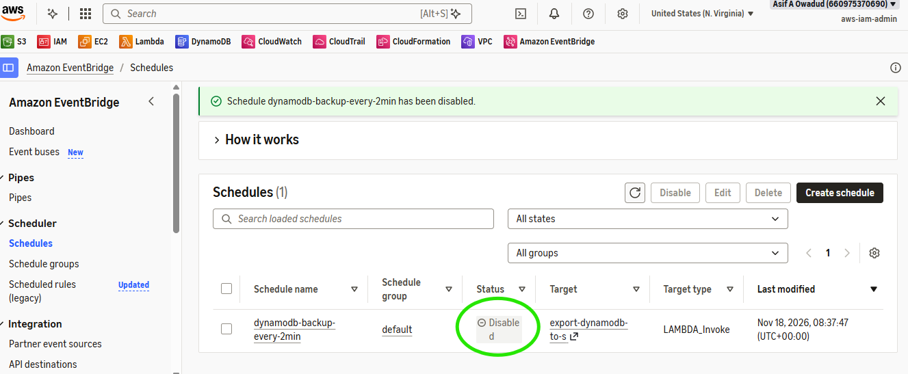

---

## IAM Design (Least Privilege)

| Role | Used by | Permissions | Why |
|---|---|---|---|
| `import-jsonplaceholder-users-role-*` | Lambda #1 | `dynamodb:PutItem` on `table/jsonplaceholder-users` + basic logging | It only **writes** users. It cannot read, delete, or touch any other table. |
| `export-dynamodb-to-s3-role-*` | Lambda #2 | `dynamodb:Scan` on the table + `s3:PutObject` on `jsonplaceholder-users-bucket/backups/*` + basic logging | It only **reads** the table and **adds** files under one prefix. It has no delete permission, so even buggy code cannot erase existing backups. |
| `Amazon_EventBridge_Scheduler_LAMBDA_*` | EventBridge Scheduler | `lambda:InvokeFunction` on Lambda #2 | The scheduler can only **start** the function. It has no access to DynamoDB or S3. |

The policy files are in [`iam_policies/`](iam_policies/). The account ID has been replaced with `ACCOUNT_ID` on purpose.

**Why not `AdministratorAccess`?** It would work, but any bug, compromised dependency, or code injection would then have full control of the account. Least privilege limits the blast radius to exactly the one action each function needs.

---

## Answers to Report Questions

**1. What is the difference between Lambda's execution role and Scheduler's execution role?**
They answer two different questions. The **Scheduler role** answers *"who may start this function?"*: it allows EventBridge Scheduler to call `lambda:InvokeFunction`. The **Lambda execution role** answers *"what may this function do once it is running?"*: Lambda assumes it to get credentials for `dynamodb:Scan` and `s3:PutObject`. The Scheduler never touches DynamoDB or S3, and the Lambda role does not need permission to invoke itself.

**2. Why does running Lambda #1 twice not produce 20 DynamoDB users?**
`PutItem` is not an append operation. It writes an item **at a given primary key**. If an item with the same `id` already exists, it is completely replaced. The API returns the same 10 ids every time, so the second run overwrites the same 10 items. That makes the import **idempotent**: running it once or many times gives the same result.

**3. Why do Lambda #2 backups have unique timestamps and request IDs?**
So that every run creates a **new object** instead of overwriting the previous one. The key combines the UTC date (one "folder" per day), the time down to microseconds, and the Lambda `aws_request_id`, which is unique per invocation. Even if two invocations started in the same microsecond (for example, a retry), their keys would still differ. This keeps a full history of exports.

**4. What is the difference between `print()` logs and Invocations/Errors metrics?**
**Logs** are detailed text events written by the code (`Saved user 3: Clementine Bauch`, `Exported 10 users to s3://...`) plus Lambda's own `START`/`END`/`REPORT` lines. They explain *what happened inside* one run and are used for debugging. **Metrics** are numeric time series that Lambda publishes automatically (Invocations, Errors, Duration, Throttles). They show *how often, how long, and whether it failed* across many runs, and they are what alarms and dashboards use. The number of users saved is a log message, not a metric. The `except` blocks re-`raise` the exception so that a failure is counted in the **Errors** metric instead of being hidden as a "successful" run.

**5. What would happen if you deleted the DynamoDB table but kept its JSON files in S3? Could the original indexes/configuration be restored from the JSON alone?**
The **item data** would survive. You could recreate a table and reload the items with a script that calls `PutItem` for each object. But the JSON contains **only items**, not the table definition. The key schema, attribute types, capacity mode, secondary indexes, TTL settings, encryption settings, tags, streams, alarms, and IAM/resource policies are all lost and would have to be rebuilt by hand or from infrastructure-as-code. Also, numbers that were stored as non-integer `Decimal` values are written as strings in the export, so their types would need care on re-import. So the answer is no: the original configuration cannot be restored from the JSON alone.

**6. Why is an export every 2 minutes usually a poor production backup strategy for large DynamoDB tables?**
- **Not a consistent snapshot.** A `Scan` reads page by page while writes continue, so one file can mix older and newer states of the table.
- **Cost and load.** Every scan reads the *entire* table and consumes read capacity. Doing that 720 times a day on a large table is expensive and competes with production traffic.
- **Lambda limits.** A Lambda run is capped at 15 minutes and has limited memory. A large table cannot be scanned and held in memory as one JSON array.
- **Storage growth.** About 30 files per hour (about 21,600 per month) of full copies, which mostly duplicate each other.
- **Data only.** As described in answer 5, the export does not preserve the table configuration.

For production, use **DynamoDB Point-in-Time Recovery (PITR)**, which restores to any second in the last 35 days without consuming table capacity, and/or the managed **Export to S3** feature for analytics copies. Choose backup frequency and retention from the workload's **RPO/RTO** requirements, and test restores regularly.

---

## Notes: Console Changes Encountered (November 2026)

The assignment instructions were written for an older AWS console. Equivalent steps in the current console:

| Assignment says | Current console |
|---|---|
| Create function → Architecture **x86_64** | "Create Event Function" → Additional settings → **ARM64 architecture** toggle **Off** (= x86_64) |
| Execution role → **Create a new role with basic Lambda permissions** | **Custom execution role** toggle **Off** (= Lambda creates a basic role) |
| Monitor → View CloudWatch logs | Test result → **"Executing function: succeeded (logs ↗)"** link, or CloudWatch → **Logs → Log Management → Log groups** |

---

## Lessons Learned

- A DynamoDB partition key's **type** must match the data. `1` and `"1"` are different keys.
- Keep configuration (table and bucket names) in **environment variables**, and make sure it matches the IAM policy. A `BACKUP_PREFIX` outside `backups/` would be denied.
- Clients created **outside** the handler are reused across warm invocations, which reduces cold-start cost (visible as *Init duration* on the first run only).
- S3 has no real folders. A "folder" is just a key prefix that appears when the first object is written.
- Cleanup order matters: **disable the schedule first**, otherwise it keeps invoking a deleted function. Delete only the roles this lab created, and never touch `AWSServiceRoleFor*` service-linked roles.

---

## Repository Structure

```
.
├── README.md
├── lambda_src/
│   ├── import_users/lambda_function.py    # Lambda #1
│   └── backup_users/lambda_function.py    # Lambda #2
├── iam_policies/
│   ├── lambda-import-putitem-policy.json  # Lambda #1 inline policy
│   └── lambda-backup-export-policy.json   # Lambda #2 inline policy
└── screenshots/                           # 01–14, account ID redacted
```

**Handler** for both functions: `lambda_function.lambda_handler`. Each function was deployed by uploading a ZIP containing only `lambda_function.py` at the root.

## Security Notes

- No AWS access keys, secrets, or account IDs are committed. The account ID is blurred in all screenshots.
- The S3 bucket stayed private with Block Public Access on and default SSE-S3 encryption.
- All lab resources were deleted after verification to avoid ongoing charges.
